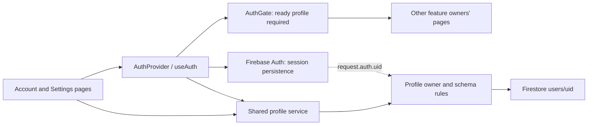
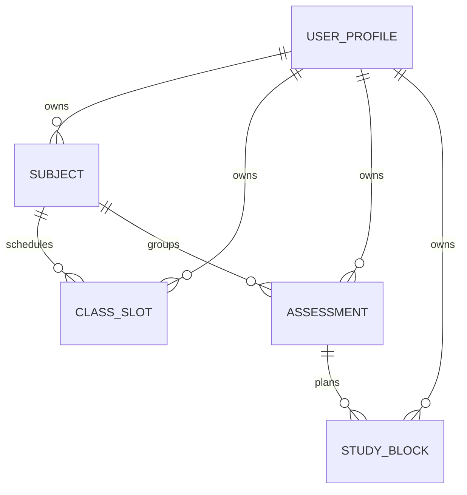

# Accounts and profile design

Software Engineering 2, Group 1. Prepared 16 October 2026 for Jandre's account/profile work and DOC-04 design contribution. This is a technical design record; stakeholder/supervisor approval is not invented. Complete application design and academic assembly remain a group responsibility.

## Requirement scope

FR-01: email/password registration, sign-in/out and session cleanup. FR-02: display-name/seven-budget editing and persistence are implemented; recalculation in the future dashboard remains an integration task. NFR-01/02/07/08: profile isolation, stored validation, error handling and reproducible checks are exercised within this module. The 35 whole-application acceptance cases are not all complete.

## Architecture



Development uses demo-studyflow with loopback Auth/Firestore. Cloud configuration is a future authorized integration; the browser never receives service-account credentials. Firestore's default in-memory cache is used; persistent disk caching is not enabled. Auth/provider state is not a substitute for server rules.

## Registration/profile sequence

```mermaid
sequenceDiagram
  actor Student
  participant Page as Account page
  participant Auth as Firebase Auth
  participant Provider as AuthProvider
  participant Profile as Profile service / Firestore
  Student->>Page: Valid name, email, password, confirmation
  Page->>Auth: Create email/password account
  Auth-->>Provider: Authenticated UID
  Provider->>Profile: Observe own confirmed profile
  alt Profile missing
    Provider->>Profile: Server preflight and transaction
    Profile->>Profile: Create only if still absent
  else Profile already exists
    Profile-->>Provider: Preserve existing profile
  end
  alt Valid confirmed profile
    Profile-->>Provider: Profile with server timestamps
    Provider-->>Page: Ready; private route may open
  else Connection, schema or permission failure
    Provider-->>Page: Profile error; account still exists
    Student->>Page: Retry profile or sign out
  end
```

A registration failure does not claim an account was created. A profile failure after successful registration explicitly says the account exists; retry reuses the same UID. Profile listeners ignore pending/cache-only snapshots, stop on timeout/session changes and reject stale callbacks. Logout immediately clears private state. A failed logout keeps the workspace locked until recovery.

## Implemented profile data dictionary

Document path: users/{uid}. The UID is the Firebase Auth UID and document key; it is not an editable stored field. Passwords are stored/managed by Firebase Auth, never Firestore.

| Field              | Type / constraint                                            | Source and update policy                                               |
| ------------------ | ------------------------------------------------------------ | ---------------------------------------------------------------------- |
| displayName        | String, trimmed 1-80 characters, single line                 | Registration/recovery or settings form                                 |
| timezone           | Literal Africa/Johannesburg                                  | Fixed release choice; cannot be changed by a client write              |
| studyBudgetMinutes | Map with exactly string keys 1 through 7 (ISO Monday-Sunday) | New profiles start with seven zeros                                    |
| Each budget        | Integer, inclusive 0-1440 minutes                            | Validated in UI, service and rules; zero is valid                      |
| createdAt          | Firestore Timestamp                                          | Server request time on creation; immutable afterward                   |
| updatedAt          | Firestore Timestamp, no earlier than createdAt               | Server request time for each accepted write; optimistic revision token |

No extra document/budget keys are accepted. A user may get/create/update only their own valid profile; profile listing and deletion are denied. The proposed subjects/classSlots/assessments/studyBlocks subcollections remain closed until their owners supply matching feature rules/tests. No index is needed for fetching a single own-profile document by UID.

## Proposed whole-planner logical model



Only USER_PROFILE persistence is implemented here. Shared [TypeScript entities](../../src/shared/types/planner.ts) preserve the proposed remaining fields. IDs/references are UID-scoped; archive/history behaviour belongs with each feature owner. This Firestore document model/data dictionary is not claimed to be SQL normalisation evidence accepted by the lecturer. Dewald still needs actual assessment-fit confirmation.

## Settings consistency and failure behaviour

The settings form keeps its editable draft separate from the last confirmed server revision. A remote profile change does not silently discard a draft. Before saving, read from the server and compare updatedAt again inside the transaction. A conflicting version aborts rather than overwriting another editor. createdAt is retained and updatedAt uses serverTimestamp. A server read confirms the committed result before success is displayed.

If a response is lost after commit, the UI cannot guarantee the server did nothing: it reports an unconfirmed operation and retains input. The user reloads the latest profile before retrying. UID changes unmount the old form; late completions never populate the next account. Each future feature has the same responsibility for its own listeners/state.

## Technical references (Harvard)

Google (n.d.) _Authenticate with Firebase using Password-Based Accounts using Javascript_. Available at: https://firebase.google.com/docs/auth/web/password-auth (Accessed: 16 October 2026).

Google (n.d.) _Authentication State Persistence_. Available at: https://firebase.google.com/docs/auth/web/auth-state-persistence (Accessed: 16 October 2026).

Google (n.d.) _Writing conditions for Cloud Firestore Security Rules_. Available at: https://firebase.google.com/docs/firestore/security/rules-conditions (Accessed: 16 October 2026).

Google (n.d.) _Build unit tests_. Available at: https://firebase.google.com/docs/rules/unit-tests (Accessed: 16 October 2026).

Google (n.d.) _Transactions and batched writes_. Available at: https://firebase.google.com/docs/firestore/manage-data/transactions (Accessed: 16 October 2026).

Read [the executed verification](../testing/Jandre_Accounts_Verification_2026-10-16.md) and [developer handoff](../development/ACCOUNTS_HANDOFF.md) with this design.
