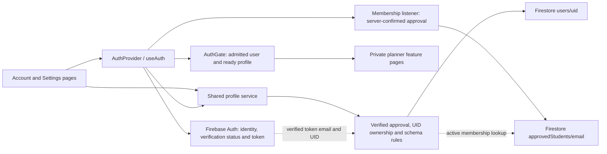
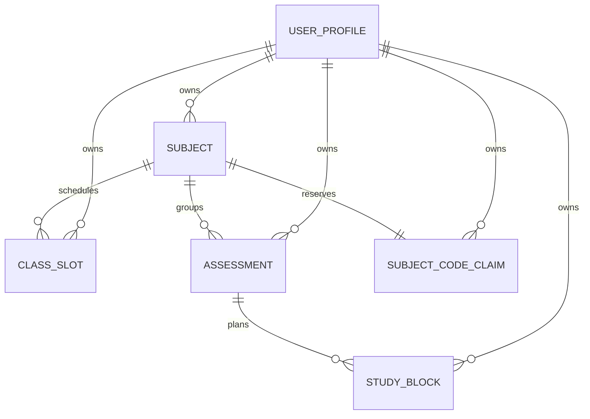

# Accounts and profile design

Software Engineering 2, Group 1. Prepared 16 October 2026 for Jandre's account/profile work and DOC-04 design contribution. This is a technical design record; stakeholder/supervisor approval is not invented. Complete application design and academic assembly remain a group responsibility.

**Current reconciliation, 19 October 2026:** incorporates the existing planner/startup corrections and verified student-access implementation at local `7e3b7b5`. Shared baseline `044eefc` was published on 16 October; these later changes are local. The original 16 October verification remains historical. Current [access verification](../testing/Student_Access_Verification_2026-10-19.md) and [cloud status](../development/CLOUD_PROJECT_STATUS.md) distinguish local results, configured backend and pending real mailbox/persistence checks.

## Requirement scope

FR-01: email/password registration, sign-in/out and session cleanup. FR-02: display-name/seven-budget editing and persistence are implemented; the live dashboard consumes the confirmed profile budgets and recalculates allocation. Full capstone acceptance still requires recorded final-version results. NFR-01/02/07/08: profile isolation, stored validation, error handling and reproducible checks are exercised within this module. The 35 whole-application acceptance cases are not all complete.

## Architecture



Development uses demo-studyflow with loopback Auth/Firestore and the same verified-approval policy as cloud rules. The real project/web app, provider, database and reviewed rules are configured with explicit authorization; real mailbox verification and complete cloud persistence/isolation still require recorded outcomes. The browser never receives service-account credentials. Firestore's default in-memory cache is used; persistent disk caching is not enabled. Auth/provider state is not a substitute for server rules.

## Registration/profile sequence

```mermaid
sequenceDiagram
  actor Student
  participant Page as Account page
  participant Auth as Firebase Auth
  participant Provider as AuthProvider
  participant Access as Approved-student listener / rules
  participant Profile as Profile service / Firestore
  Student->>Page: Valid name, email, password, confirmation
  Page->>Auth: Create email/password identity
  Auth-->>Provider: UID, email and verification status
  alt Email not verified
    Provider-->>Page: Verification required; no private profile access
    Student->>Page: Explicitly send verification email
    Page->>Auth: Request verification message
    Student->>Auth: Follow mailbox verification link
    Student->>Page: Check access again
    Page->>Auth: Reload identity and force fresh token
    Auth-->>Provider: Updated verified status
  end
  Provider->>Access: Observe own membership with verified token
  alt Server-confirmed active approval
    Access-->>Provider: Admitted
    Provider->>Profile: Observe own server-confirmed profile
    opt Profile missing
      Provider->>Profile: Server preflight and idempotent transaction
    end
    alt Valid confirmed profile
      Profile-->>Provider: Profile with server timestamps
      Provider-->>Page: Ready; private routes open
    else Profile failure
      Provider-->>Page: Profile recovery; identity still exists
    end
  else Missing, inactive, malformed or unreachable approval
    Access-->>Provider: Deny or fail closed
    Provider-->>Page: Approval/retry/sign-out controls; workspace locked
  end
  Note over Provider,Access: Membership remains observed; revocation clears private state
```

Registration creates only an Auth identity; verification messages are sent explicitly. Bare identity creation does not grant private data access. A registration failure does not claim an account was created. A profile failure after successful registration explicitly says the account exists; retry reuses the same UID. Profile listeners ignore pending/cache-only snapshots, stop on timeout/session changes and reject stale callbacks. Logout immediately clears private state. A failed logout keeps the workspace locked until recovery.

## Implemented profile data dictionary

Document path: users/{uid}. The UID is the Firebase Auth UID and document key; it is not an editable stored field. Passwords are stored/managed by Firebase Auth, never Firestore.

| Field              | Type / constraint                                            | Source and update policy                                               |
| ------------------ | ------------------------------------------------------------ | ---------------------------------------------------------------------- |
| displayName        | String, trimmed 1-80 characters, single line                 | Registration/recovery or settings form                                 |
| timezone           | Literal Africa/Johannesburg                                  | Fixed release choice; cannot be changed by a client write              |
| studyBudgetMinutes | Map with exactly string keys 1 through 7 (ISO Monday-Sunday) | New profiles start with seven zeros                                    |
| Each budget        | Integer, inclusive 0-1440 minutes                            | Validated in UI, service and rules; zero is valid                      |
| createdAt          | Firestore Timestamp                                          | Server request time on creation; immutable afterward                   |
| updatedAt          | Firestore Timestamp, no earlier than createdAt               | Server request time for each accepted write; optimistic revision token |

No extra document/budget keys are accepted. A verified, actively approved user may get/create/update only their own valid profile; profile listing and deletion are denied. The subjects/classSlots/assessments/studyBlocks subcollections now have explicit owner/schema/reference rules and backend tests. subjectCodes holds atomic uniqueness claims containing only subjectId; these claims have no timestamps. Business-record hard deletes are denied; an old code claim may be deleted only during a valid code rename. No index is needed for fetching a single own-profile document by UID.

## Administrative membership dictionary

Document path: `approvedStudents/{normalizedEmail}`. Exactly one stored field, `active: boolean`, is permitted by the admission contract. The lowercase supported ASCII email ID is matched to the verified Firebase token email; it is not a stored profile foreign key. No name, student number, role or password is stored here. The trusted project administrator maintains this list outside app-client writes; students can get only their own status after verification and cannot list or change entries.

Missing, inactive or malformed entries deny private access. Cached approval cannot unlock the UI. Admission and all private operations remain independently enforced by rules; a route guard alone is insufficient. Deactivation retains existing documents but denies subsequent access. This capstone team's approved list does not independently certify enrolment or institutional endorsement. Read the [access contract](Student_Access_Contract.md) and [run/admin guide](../development/STUDENT_ACCESS.md).

## Implemented whole-planner logical model



All entities shown are implemented at baseline 044eefc. Shared [TypeScript entities](../../src/shared/types/planner.ts), runtime adapters and rules define the actual persisted fields; code claims are internal bookkeeping. All child paths are under users/{uid}; document keys are not additional stored owner/id fields. References are strings to same-owner documents, not SQL foreign keys. Archive/cancel history is retained. Use [the current planner contract](Planner_Data_Contract.md) for the complete private model and the membership dictionary above for administration. Riaan's earlier corrected 19 October export predates this access-policy addition and requires an updated assessment copy. Lecturer acceptance of Firestore schema/ERD/normalisation evidence remains unconfirmed.

## Settings consistency and failure behaviour

The settings form keeps its editable draft separate from the last confirmed server revision. A remote profile change does not silently discard a draft. Before saving, read from the server and compare updatedAt again inside the transaction. A conflicting version aborts rather than overwriting another editor. createdAt is retained and updatedAt uses serverTimestamp. A server read confirms the committed result before success is displayed.

If a response is lost after commit, the UI cannot guarantee the server did nothing: it reports an unconfirmed operation and retains input. The user reloads the latest profile before retrying. UID changes unmount the old form; late completions never populate the next account. Planner services/workspace apply corresponding guards to their listeners and state.

## Technical references (Harvard)

Google (n.d.) _Authenticate with Firebase using Password-Based Accounts using Javascript_. Available at: https://firebase.google.com/docs/auth/web/password-auth (Accessed: 16 October 2026).

Google (n.d.) _Authentication State Persistence_. Available at: https://firebase.google.com/docs/auth/web/auth-state-persistence (Accessed: 16 October 2026).

Google (n.d.) _Writing conditions for Cloud Firestore Security Rules_. Available at: https://firebase.google.com/docs/firestore/security/rules-conditions (Accessed: 16 October 2026).

Google (n.d.) _Build unit tests_. Available at: https://firebase.google.com/docs/rules/unit-tests (Accessed: 16 October 2026).

Google (n.d.) _Transactions and batched writes_. Available at: https://firebase.google.com/docs/firestore/manage-data/transactions (Accessed: 16 October 2026).

Read [the executed verification](../testing/Jandre_Accounts_Verification_2026-10-16.md) and [developer handoff](../development/ACCOUNTS_HANDOFF.md) with this design.
