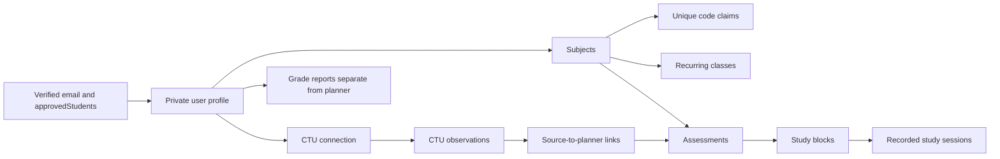

# Final data model and scope addendum

28 October 2026. Read alongside the core ERD and member chapter drafts. This corrects earlier emulator-only descriptions. Source types, parsers and `firebase/firestore.rules` define the implemented constraints.

## Stored data

Private collections below live under `users/{uid}`. Access requires the authenticated owner, verified email and active exact-email `approvedStudents` membership. Students cannot edit that allowlist. No Firebase admin credentials are in the browser app.

| Path                           | Purpose and relationship                                             | Contract                          |
| ------------------------------ | -------------------------------------------------------------------- | --------------------------------- |
| `users/{uid}`                  | Display name, SAST timezone and seven daily budgets                  | Planner types and profile service |
| `subjects/{id}`                | Name, unique code, colour and archive state                          | Planner types/parser              |
| `subjectCodes/{code}`          | Atomic uniqueness claim pointing to one subject                      | Planner service/rules             |
| `classSlots/{id}`              | Subject reference, weekly times and inclusive active dates           | Planner types/parser              |
| `assessments/{id}`             | Subject, title/type, deadline, priority, progress and estimate       | Planner types/parser              |
| `studyBlocks/{id}`             | Assessment, interval and Planned/Done/Cancelled state                | Planner types/parser              |
| `ctuConnections/current`       | Current source account/course, coverage and observed IDs             | CTU import contract               |
| `ctuItems/{hash}`              | Module/assessment/document/resource observations                     | CTU import contract               |
| `ctuPlannerLinks/{sourceHash}` | Source-to-assessment link; applied title/date, revision and conflict | CTU planning contract             |
| `studySessions/{id}`           | Immutable recorded seconds linked to an own block                    | Study-session service             |
| `gradeReports/{hash}`          | Course/year/report-kind payload with module/component marks          | Grade contract/page               |

This is a relationship overview. Riaan's `ERD_logical.drawio` and PNG cover the original core planner model, not later CTU/timer/grade extensions. Preserve attribution when combining them into Chapter 4.

## Data lifecycle

Planner writes use exact schemas, owner-scoped references, server timestamps and revision checks. Subject-code claims and subject saves are atomic. Archive/restore and cancellation retain history; clients cannot hard-delete records. These controls reduce known invalid writes, without guaranteeing that every possible corruption or attack is impossible.

CTU sync uses stable observation IDs. Missing entries remain because portal coverage can be incomplete. Student edits, estimates, priority and completion remain theirs. Conflicting title/date changes are flagged. A source transaction can succeed before later link refresh fails; the UI reports partial saving and retry is idempotent.

Timer ticks remain local. Explicit saving writes immutable active seconds, excluding pauses, linked to a block; sufficient recorded time can mark it Done. This measures timer use, not independently verified studying. Unsaved timer progress does not survive a full reload. Notifications require permission and an open app.

Grade PDFs are parsed on-device. Original PDFs, identity numbers and absenteeism are excluded from saved reports. Numeric module Overall marks count once in an unweighted average; pending results are not zero. Historical grades never create planner tasks.

## Operating and evaluation boundaries

`npm run dev` uses real Firebase from a local frontend; `npm test` uses isolated local emulators. Hosting remains unpublished, Spark/no billing is retained, and no paid backups are configured. Git preserves rules and code, not a backup of student records.

Facilitator administration, attendance credit, quizzes, CSV export, dark mode, automatic timetable extraction and CTU SSO/API integration are outside implemented scope. The unpacked helper requires manual installation. Chromium/Firefox build output is separate from actual portal acceptance testing.
