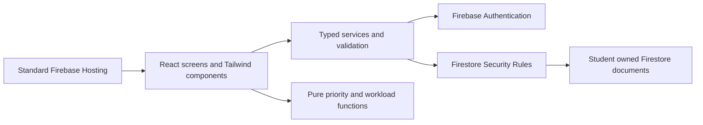

# StudyFlow student planner project plan

Planning baseline: **15 October 2026**, Africa/Johannesburg. **StudyFlow is a proposed working name.** Jandre has confirmed the direction is a student planner and the stack must be minimal. **Dewald Van Jaarsveldt is team lead; Aneesah Rehman is minute-taker**, confirmed by Jandre today. Jandre has now confirmed the five Group 1 students as the client and primary stakeholders. Technical assignments, final name, stack adoption and supervisor approval are not yet confirmed. This is a complete proposed plan, not an implemented system or a completed assessed dissertation.

## 1 Recommended product and stack

Build a responsive personal planner for one student cohort. It brings subjects, class times, assignments/exams and planned study blocks into one place. The useful extra is a transparent next-task recommendation and a warning when a student plans more study than their own time budget.

**Recommended stack following Jandre's question: React + TypeScript + Tailwind CSS + Firebase.** Use Vite as the development/build tool, Firebase Authentication for email/password accounts, Cloud Firestore Standard edition for data, and standard Firebase Hosting for the compiled application. There is one frontend project and one managed backend platform. This recommendation replaces the earlier Django/Bootstrap/SQLite suggestion for this plan; it is not a claim that the group has adopted the stack.

| Part | What it supplies | Scope decision |
| --- | --- | --- |
| React | Reusable screens, forms, state and navigation | One small single-page application; built-in component state/context is sufficient. |
| TypeScript | Typed entities, service contracts and pure calculations | Use strict checking; still validate submitted data at runtime and in database rules. |
| Tailwind CSS | Consistent responsive styling | Use the official Vite integration; a small shared component set rather than another UI framework. |
| Firebase Authentication | Account creation, sign-in and sign-out | Email/password first; no custom password storage. |
| Cloud Firestore | Persistent student-owned documents | Explicit schemas and owner-only security rules; tests against the emulator. |
| Firebase Hosting | Hosting the built Vite files | Standard static Hosting, not Firebase App Hosting. Deployment remains a separately authorized action. |
| Development checks | Build/type checking, lint, pure-function tests and rules tests | Vite toolchain, Vitest and Firebase rules testing; these are development tools, not additional application servers. |

The React/TypeScript starter is supported by [Vite](https://vite.dev/guide/), and [Tailwind documents its Vite integration](https://tailwindcss.com/docs/installation/using-vite). [Firebase Hosting](https://firebase.google.com/docs/hosting) supports static and single-page apps. Exact compatible versions must be selected and locked at implementation setup; no packages have been installed for this application.

### Budget and setup

Plan around Firebase's **Spark** plan and its quotas, with no billing upgrade. [Firebase's pricing page](https://firebase.google.com/pricing) currently lists no payment method for Spark and no-cost quotas for Firestore and standard Hosting. Usage must be checked during development; this is a proposed no-cost scope, not an unlimited-usage promise.

Keep file uploads and Cloud Functions out of the first version. [Cloud Storage currently requires Blaze](https://firebase.google.com/docs/storage/faq-and-troubleshooting), and Functions deployment is not included on Spark. In-app alerts need neither scheduled functions nor messaging services: compute them while the app is open. Use text task notes rather than uploaded documents. No Firebase project, account, billing plan, repository or deployment has been created by the assistant.

### Database assessment check

[Firestore stores documents in collections, rather than SQL tables](https://firebase.google.com/docs/firestore/data-model). The SE2 briefs request ERD/database design, a schema script and normalisation evidence. They do not name a mandatory database vendor. **Dewald should confirm that a Firestore document schema, logical relationship diagram, data dictionary, rules/index files and data-design rationale are accepted for those deliverables before the stack is locked.** Do not label document IDs as enforced SQL foreign keys or pretend Firestore has relational normalisation constraints. If the supervisor explicitly requires SQL, revise the storage architecture before implementation; do not build two backends.

## 2 Real problem and client

**Problem hypothesis to validate:** students in a busy software engineering cohort receive deadlines and class information through several channels, struggle to see competing work together, and may plan more study than their available time. A basic task list does not show the relationship between a deadline, its remaining effort and the student's week.

Client update, 15 October 2026: Jandre confirmed that the five Group 1 students are the client and primary stakeholders; the planner is for their own use. The group will document its real planning methods, concrete scenarios and prioritised needs. The problem hypothesis has not yet been established as a measured finding about CTU or the wider class. Additional willing students may provide feedback if feasible; no outside client representative is required by this chosen arrangement. Jabulile Mashibini is the supervisor. This records the user's client choice, not supervisor approval of the proposal.

Primary user: an individual student managing their own study. Additional stakeholders: other willing students who provide evaluation feedback, and the supervisor as assessor. The first version has no lecturer/parent monitoring portal and no shared editing of another student's planner. Students can record a group-project deadline as their own assessment without building a group collaboration platform.

### Questions for initial requirements gathering

1. Where do your deadlines and class times currently come from?
2. Which planning task takes the most effort or causes mistakes?
3. How do you decide what to work on first?
4. Do you estimate remaining work and reserve study time? What would be useful to see?
5. Can you show a non-sensitive example and later try five short planning tasks?

Record the method, actual participants/consent where required, date, findings and limitations. Use synthetic academic records for development and demonstrations. Collect only what is needed; no student numbers, marks or sensitive personal information are required by the proposed app.

## 3 Proposed aim objectives and research questions

**Aim:** design, develop and evaluate a responsive student planner that helps the selected cohort organise academic commitments and make clearer short-term study decisions.

| Objective | Proposed measurable outcome | Matching research question | Evidence |
| --- | --- | --- | --- |
| O1 Analyse planning needs | Document at least five prioritised needs from actual gathering evidence and compare three existing systems. | RQ1: What planning needs and difficulties matter to the selected students? | Gathering notes, literature matrix, stakeholder review and SRS. |
| O2 Design the solution | Produce architecture, use cases, class/activity/sequence diagrams as relevant, logical data model and wireframes traceable to all must-have requirements. | RQ2: What design supports those needs with a small maintainable system? | Chapter 4 design and traceability matrix. |
| O3 Build a working planner | Deliver every must-have acceptance criterion, persistent data and per-user access control. | RQ3: Can the minimal stack deliver the required personal planning workflow? | Actual app, commits, acceptance and rules tests. |
| O4 Provide understandable planning support | Pass defined ordering/budget boundary tests and show clear explanations of recommendations. | RQ4: Can users understand the rule-based recommendations and workload warnings? | Deterministic tests and participant task feedback. |
| O5 Evaluate usefulness and quality | Run the documented test plan and a small task-based evaluation, reporting task success, time, errors and feedback. | RQ5: How usable and reliable is the implemented planner for these tasks? | Chapter 5 results and Chapter 6 answers/limitations. |

These are proposed objectives and targets, not completed research or promised marks. A short evaluation cannot prove better academic grades or long-term study habits.

## 4 Scope that can be finished

### Must-have first release

| Module | Student capability | Why it belongs |
| --- | --- | --- |
| Accounts and privacy | Register, sign in/out, manage display name and study budgets; access own records only. | Persistent personal planning and meaningful security evidence. |
| Subjects and classes | Add/edit subjects with colours and a simple weekly class pattern. | Real academic context and data relationships. |
| Assessments | Add assignments, tests/exams and projects with exact due time, priority, remaining minutes and status; search/filter, complete/reopen and archive. | The core workflow and measurable validation. |
| Weekly planner | See classes, due assessments and dated study blocks in a week view; create/edit/cancel/complete blocks. | Useful visual demonstration and integration across modules. |
| Next-task advice | Rank incomplete assessments using explicit rules and show why an item is near the top. | A small, testable business-logic feature beyond record entry. |
| Workload and progress | Compare allocated study minutes against the student's chosen daily budget; show overdue/due-soon tasks and completion counts. | Clear planning value and simple calculations. |

Use a single weekly class pattern active between a start and end date. A class cannot run through midnight. Study blocks are dated, stay within one local day and last 15-180 minutes. There is no rotating A/B timetable or holiday engine in the first version. The calendar uses a readable seven-day agenda/grid, not a drag-and-drop scheduling engine.

### Add only after must-haves pass

- **Should:** CSV export of the student's assessment list with subject/due/status fields.
- **Could:** an optional focus timer using an end timestamp; it must not write to Firestore every second. It is a separate polish task, not a prerequisite for the weekly planner.
- **Could:** dark mode if a coherent light theme and all core states are already finished.

At the first integrated review, choose at most one optional feature. No optional feature should displace privacy rules tests, data persistence, required dissertation evidence or the recorded walkthrough.

### Outside this release

Native mobile apps, external calendar/LMS integration, document uploads, messaging, lecturer/parent dashboards, shared group workspaces, social feeds, marks/GPA prediction, an AI service, automatic optimisation of an entire semester and a complete offline-sync implementation. These would expand dependencies, rules or evaluation beyond the short schedule.

## 5 What makes it impressive

The strongest demonstration is a coherent workflow, not a large menu of unfinished features:

1. A student sees colour-coded subjects, the next class, upcoming deadlines and study blocks on a polished dashboard.
2. Adding a high-priority assessment due soon changes the explained next-task list.
3. Planning two 45-minute study blocks on a day with a 60-minute study budget produces a clear **30-minute over-budget** warning.
4. A block overlapping a known class produces a warning before the student confirms or changes it.
5. Completing an assessment removes it from outstanding-work advice while retaining the history of saved study blocks.
6. Reloading proves persistence; signing in as a second student demonstrates independent data and denied cross-user access.

Visual identity: a clean light interface, dark blue text, one accent colour, muted surfaces and labelled subject colours. Desktop sidebar and compact mobile navigation; consistent form components; readable contrast, visible focus, loading, empty, saved and error states. Use Tailwind progress bars and simple lists rather than a separate charting package. Due-date labels must include text, not rely on red/green alone.

## 6 Screens and navigation

| Screen | Main content | Primary actions |
| --- | --- | --- |
| Welcome / sign-in | Product purpose, sign-in form and registration | Register, sign in; recover password using Firebase's supported flow if included in setup. |
| Dashboard | Today, next class, three recommended tasks with reasons, due/overdue counts, today's study allocation | Add assessment, plan a block, open weekly view. |
| Assessments | Search, subject/status filters, deadline and remaining-effort fields, completed/archive views | Add/edit, mark complete/reopen, archive/restore. |
| Subjects and classes | Subject colour/name/code and weekly class slots with dates/time/location | Add/edit subject and class slot; archive a subject. |
| Weekly planner | Previous/current/next week; chronological classes, assessment due markers and study blocks | Plan/edit/cancel a block; mark a past/current block done; inspect warnings. |
| Settings | Display name, fixed planning timezone and seven daily study budgets | Save budgets; sign out. |

Assessment editing and study planning can use ordinary forms/panels. Reuse the same form for creating and editing each entity. Build real screens for students; Firebase Console is not the application UI.

## 7 Rules for recommendations and workload

### Time and status conventions

All planning is displayed in **Africa/Johannesburg** for this first release. Store actual instants as Firestore timestamps; class slots store weekday and local wall-clock start/end plus active date range. Centralise conversions and test near midnight. Take one `now` instant for each calculation/render so labels do not disagree at a boundary.

Assessment status: To Do, In Progress, Completed. Overdue is derived when an incomplete assessment has `dueAt < now`; it is not a fourth stored status. An item exactly at its due instant remains due-now until time passes. Archived items are excluded from advice and active counts but retained in history.

Remaining effort is a **student-maintained estimate**. Reserving a study block does not count as studying and does not reduce the estimate. The student can update remaining minutes after work. Marking an assessment complete sets remaining effort to zero and a completion timestamp; reopening requires a new positive remaining estimate. This avoids inventing progress from a planned calendar entry.

### Explained next-task ordering

For non-completed, non-archived assessments, calculate an urgency bucket:

| Bucket | Condition |
| --- | --- |
| 0 | Deadline before now: overdue. |
| 1 | Deadline from now up to and including 24 hours away. |
| 2 | More than 24 and up to 72 hours away. |
| 3 | More than 72 and up to 168 hours away. |
| 4 | Later than 168 hours. |

Sort by bucket, then manual priority High/Medium/Low, then earliest due time, then least remaining effort, then document ID for a stable tie. Show explanations such as **Due within 24 hours; High priority**. A task of 30 minutes or less may have a **Quick task** badge; the badge does not override the sort order. This is transparent rule-based advice, not an optimal schedule or a prediction of academic success.

### Daily study allocation

Each student enters a budget in minutes for Monday-Sunday, including zero for a day with no study capacity. Suggested starting values are shown for review, not assumed to reflect their real availability.

For a local day, sum durations of that student's non-cancelled study blocks, including blocks marked done. This measures **allocated session time**, not verified actual study. Compare with that weekday's budget. Example: 90 minutes allocated minus 60 budget = **30 minutes over budget**. Zero-budget days with a block must warn; the interface must not divide by zero when drawing a progress bar. Show the number even when a visual bar caps at 100%.

Classes are displayed separately and do not consume this outside-class study budget. Clash warnings handle known class overlap. Budgets are a student's self-declaration; the app does not infer every available minute in their life.

### Conflict warning and retained history

Intervals overlap when `newStart < existingEnd` and `existingStart < newEnd`. Touching endpoints are not a clash. Compare against class occurrences in their active range and non-cancelled study blocks on that local date. Highlight the conflicting title and time; let the student change the block or explicitly keep the overlap. This is an **advisory check against the currently loaded planner**, not a server-enforced global calendar lock; simultaneous browser edits require refresh/review.

Completing or archiving an assessment does not delete its saved study blocks. Future blocks remain visible with the assessment's completed/archived label so the student can cancel or repurpose them. Their reserved time continues to count until cancelled. This is an explicit history policy, with no cascading query/write process hidden in the complete action.

## 8 Architecture and data design

Use feature folders and a small shared layer. Screens call services, rather than duplicating Firestore operations. Pure calculations accept data and an explicit time parameter, so they can be unit-tested without Firebase. React context stores signed-in identity and the loaded planner data; no extra state-management package is needed initially. One application repository, one TypeScript codebase and one Firebase configuration.

### Firestore document layout

| Path | Fields and responsibility |
| --- | --- |
| `users/{uid}` | displayName, timezone, studyBudgetMinutes map keyed by ISO weekday 1-7, createdAt, updatedAt. No password fields. |
| `users/{uid}/subjects/{subjectId}` | name, code, colour token from an allowed set, archived, createdAt, updatedAt. |
| `users/{uid}/classSlots/{slotId}` | subjectId, weekday 1-7, local start/end time, activeFrom/activeTo dates, optional location, archived, timestamps. |
| `users/{uid}/assessments/{assessmentId}` | subjectId, title, type Assignment/Test/Exam/Project, description, dueAt, priority, status, remainingMinutes, archived, completedAt, timestamps. |
| `users/{uid}/studyBlocks/{blockId}` | assessmentId, title, startAt, endAt, status Planned/Done/Cancelled, timestamps. Subject comes through its assessment. |

Authentication accounts live in Firebase Authentication. Subject IDs and assessment IDs are logical references inside the same user's documents. Do not duplicate subject names/colours into every block; look them up through the loaded records. Archive subjects and assessments to retain relationships rather than deleting referenced parents. Existing records remain viewable after their subject is archived; hide archived subjects from new-record choices.

Logical relationships: one user has many subjects, class slots, assessments and blocks; a subject has many slots and assessments; an assessment has many study blocks. Document those cardinalities in the design diagram and distinguish logical references from enforced SQL foreign keys. Explain any future deliberate denormalisation instead of calling the design a normalised relational database.

### Validation and security boundary

- A signed-in user's UID must match the `{uid}` path for every read/write. Deny unauthenticated access and access to another user's documents.
- Rules validate allowed/required keys, types, field lengths, enums, numeric limits and timestamp relationships; TypeScript alone does not secure stored data.
- Validate subject/assessment references within the same owner's path. A user cannot link a block to another user's assessment.
- Root profile creation/update is owner-only. The app does not store passwords, staff roles or global read permissions in editable profile fields.
- Use non-destructive archive actions for referenced records. Public collection reads, test-mode rules and client-side-only privacy are not acceptable.
- Render user text as text, keep production secrets/service-account keys out of the browser, and clear in-memory planner data on sign-out/account change. Firebase client configuration does not replace rules.
- Use `[start,end)` interval semantics, capped input lengths, sensible minute limits and explicit loading/error states. A failed write must not display a successful save or erase the form.
- Allocate a new record ID once when submitting a form and retain it through an uncertain save/retry. Reuse that ID so retrying cannot create a duplicate assessment or study block; report a pending/error state until persistence is confirmed.

[Firebase's rules guidance](https://firebase.google.com/docs/rules/basics) describes owner-based restrictions, and its [field-validation guidance](https://firebase.google.com/docs/firestore/security/rules-fields) covers schema checks. Define the exact rules and emulator tests during implementation, not just screenshots of configuration.

### Reads queries and consistency

For a small course demo, load the signed-in student's modest dataset, including archived references needed to label retained history, then calculate filters, weekly views and advice locally. Bound demo data volume rather than silently limiting query results. Use at most one listener per core collection and detach all listeners on account change/unmount; no listener per card, timer tick or rendered row. Keep cancellation/errors visible. Record read volume and dataset limits before deployment. If the intended dataset grows, implement date-range/pagination queries and preserve required Firestore indexes in version control; do not silently truncate a student's records and present incomplete metrics.

Firestore does not automatically prevent all multi-document inconsistencies. Keep this app single-owner, use merge/updated timestamp behaviour deliberately, re-check after concurrent edits, and document known limitations. High-volume collaboration and automatic timetable optimisation are outside scope.

## 9 Five-person implementation ownership

Confirmed meeting roles remain separate from technical assignments. The following technical split is **proposed**, based on Jandre's known general background; the other members' skills/availability have not been supplied.

| Member | Confirmed role | Proposed technical module | Academic coordination | Important test/evidence |
| --- | --- | --- | --- | --- |
| Jandre Van Zyl | Team member; specific role unassigned | A: foundation, auth, shared types/services, Firestore rules and integration support | Architecture/data design with each module owner's input | Account isolation, malformed writes, setup, shared contract checks. |
| Riaan Jacobs | Team member; specific role unassigned | B: subjects and weekly class slots | Chapter 1/problem/objective drafting coordination | Subject ownership, date/time validation and class occurrences. |
| Dewald Van Jaarsveldt | **Team Lead** | C: assessment workflow, search/filter and complete/reopen/archive | Requirements/SRS and work-plan coordination | Exact deadlines, status rules, remaining effort and own-record actions. |
| Omphemetse Dikeledi | Team member; specific role unassigned | D: weekly view and study-block forms/state | UI/UML/design explanation coordination | Date boundaries, interval overlap warning and saved block behaviour. |
| Aneesah Rehman | **Minute-taker** | E: dashboard, priority ordering and budget/progress calculations | Literature/source coordination and meeting/action records | Stable ordering, numeric correctness, zero budgets and visible explanations. |

Testing is performed by every module owner. Choose a coordinator to consolidate Chapter 5 and the supplied test/defect/traceability workbooks; do not give the entire testing burden to one person. Review Chapter 6 and the presentation as a team. Research/source collection can be distributed, especially because minutes and leadership add workload. Rebalance B-E if members' skills differ.

Everyone contributes genuine commits, module tests, design/requirements notes, screenshots and a demo explanation. The lead coordinates review, integration and submissions while still building a module. The minute-taker records real decisions, actions, owners and deadlines; minutes alone do not replace her technical contribution.

## 10 Delivery dates and checkpoints

Detailed owner tasks are in `Student_Planner_Delivery_Backlog.md`. Course dates are unchanged; internal targets below are proposed for team agreement.

| Date | Checkpoint | Expected evidence |
| --- | --- | --- |
| Thu 15 Oct | Finalise problem/client access, scope, roles and stack feasibility; prepare proposal for group review | Actual client plan, one-page proposal content, decision/action record; NoSQL question assigned to Dewald. |
| Fri 16 Oct, before practical | Group Lead submits proposal via Teams; record submission and subsequent approval separately | Group1_Week1.pdf and real submission/approval evidence. |
| Fri 16-Sun 18 Oct, after approval | Research and design alongside a first vertical slice; all members commit meaningful work | Chapters 1-3, SRS, architecture/UML/data/UI, ethics/plan, actual auth-to-saved-assessment flow, schema/rules draft. |
| Mon 19 Oct, 12:00 | Week 2 and Week 3 PDFs together | All stage deliverables; GitHub page 1; complete SRS in Week 3; each member's first commits and real early development evidence. |
| Mon 19-Tue 20 Oct | Integrate core subjects, classes, assessment flow and weekly display | Reviewed feature branches; owner/validation/integration tests; defects logged. |
| Wed 21 Oct | Complete study blocks, advice and workload; freeze must-have scope | One complete user journey; tested calculations and permissions; no new large features. |
| Thu 22 Oct | Full test/retest cycle, small participant review if approval/availability permit, prepare draft/recording | Actual results, traceability, defects/retests, evaluation data, Chapters 1-5 and Chapter 6 outline, individual forms. |
| Fri 23 Oct, 12:00 | Week 4 review package | Working app/access, 3-5 minute recording, dissertation/test evidence and presentation plan. |
| Sat 24-Tue 27 Oct | Apply feedback, fix defects, complete evaluation and Chapter 6 | Objective/question answers supported by results, limits, references/appendices, verified run instructions. |
| Wed 28 Oct | Rehearse, inspect final package and prepare backup | Every member explains work; clean setup tested; live demo path and recording/screenshots available. |
| Thu 29 Oct | Final submission and presentation arrangements | Official portal package; final cutoff/presentation slot still to confirm; formal attire and contribution evidence. |

The plan assumes meaningful work from five people, scope discipline and existing ability to learn/use the selected stack quickly. If the team cannot produce the first vertical slice by 18 October, cut optional polish and simplify calendar interaction before adding features; keep persistence, data isolation and the accepted must-haves intact or agree a recorded scope change.

## 11 Test plan and evaluation

`Student_Planner_Requirements_and_Tests.md` contains the proposed requirements and test matrix. Use Vitest for pure TypeScript rules/calculations and Firebase Emulator Suite with rules-unit-testing for actual database permission/validation checks. The [official emulator rules documentation](https://firebase.google.com/docs/firestore/security/test-rules-emulator) supports this approach. Perform browser acceptance/usability checks separately. No application tests have been executed in this planning session.

Prioritise: two-account access denial; invalid document writes; midnight/deadline boundaries; invalid class/study intervals; completed/archive filtering; stable advice ordering; zero-budget and cancelled-session calculations; failed saves; persisted reloads; sign-out listener cleanup; mobile/keyboard use.

Proposed small evaluation: recruit 3-5 willing students outside the authors where feasible, following required approval/consent. If Group 1 members evaluate their own app, explicitly record developer/user bias and keep those results distinct from independent feedback. Ask each participant to add a subject/class, capture an assessment, find the most urgent work, plan a block and interpret an overload warning. Record task completion, time/errors, a short usefulness rating and open feedback. For an exploratory baseline comparison, use matched mock tasks and balance/reverse the order between a plain task sheet and the app where feasible. Report the small convenience sample and learning/order effects. Do not generalise to improved grades, reduced failure rates or proven long-term behaviour.

Proposed acceptance targets: all must-have cases pass, no unresolved critical/high privacy or data-loss defect, all defined permission-denial tests pass, core actions understandable to at least 4 of 5 participants if five participate, and documented read-only calculation responsiveness. Adjust participant-related targets to the actual approved sample and report exact results rather than inventing a denominator.

## 12 Research and defensible contribution

Three credible existing-system starting points, checked 15 October 2026:

| System | Verified comparison direction | What to investigate for the local cohort |
| --- | --- | --- |
| [MyStudyLife](https://mystudylife.com/tour/) | Classes, tasks, dashboard and academic scheduling are documented. | Entry effort, clarity of urgency, support for the selected cohort's study-planning workflow. |
| [Power Planner](https://powerplanner.net/) | Assignments/exams, weekly class schedules and academic tracking are documented. | Which features are useful or unnecessary for this narrow first release. |
| [myHomework](https://info.myhomeworkapp.com/digital-student-planner.html) | Task/due/progress tracking and school support workflows are documented. | How a private vocational-student planner differs from school/teacher/parent workflows. |

Do not claim these tools lack prioritisation/budget support without directly investigating it. The proposed contribution is a deliberately small workflow, understandable recommendation rules and evaluation for a specific student setting, not invention of student planning.

A verified academic starting point is Aeon, B., Faber, A. and Panaccio, A. (2021), [Does time management work? A meta-analysis](https://journals.plos.org/plosone/article?id=10.1371/journal.pone.0245066), *PLOS ONE*, 16(1), e0245066. It supports investigating planning/time-management needs; it is not evidence that this unbuilt app improves performance. Add relevant peer-reviewed student self-regulation/usability research and official technology sources toward the recommended eight or more credible sources. Keep Harvard references and the supplied literature matrix; the source list here is a starting point, not a completed literature review.

## 13 Dissertation and rubric evidence

| Criterion | Planned evidence from this project |
| --- | --- |
| Problem/objectives, 10/100 | Verified cohort context, focused problem, one aim, five aligned objectives/questions, explicit exclusions. |
| Literature/gap, 10/100 | Critical comparison of three systems and credible research; justified local contribution. |
| Requirements/method, 10/100 | Prioritised FR/NFR, acceptance criteria, gathering evidence, iterative method compared with Waterfall. |
| Design, 12.5/100 | Architecture, logical entity/document relationships, data dictionary, use cases/UML, wireframes and explained NoSQL integrity/duplication decisions. Obtain acceptance of the data-design approach. |
| Implementation, 20/100 | Real persistent planner with complete user journey, validation, error states and run instructions. |
| Git/team evidence, 7.5/100 | Each person's genuine feature/test commits, feature branches, review/merge evidence and contribution records. |
| Testing/evaluation, 12.5/100 | Rules/unit/browser tests, actual outcomes, defect fixes/retests, traceability and honest task-based evaluation. |
| Documentation, 7.5/100 | Consistent six chapters, Harvard sources, labelled figures/tables, readable diagrams and all required final material. |
| Demo, 7.5/100 | Problem-to-result story, working example, backup and prepared explanations. |
| Individual response, 2.5/100 | Each member explains their module, decisions, tests and problems solved. |

Choose a short iterative approach: agree and freeze a small baseline, deliver vertical slices, review daily, test during the build, and incorporate real feedback. Compare with a sequential Waterfall approach in Chapter 3 using the short schedule and evolving student feedback as reasons, rather than claiming full Scrum ceremonies were followed if they were not.

## 14 Proposed demonstration

In 3-5 minutes: sign into a seeded synthetic account; show the dashboard; add an assessment due soon and inspect its explanation; open the week view; plan two blocks that exceed the daily budget; demonstrate a known overlap warning; mark an assessment complete and show updated advice; reload to prove persistence; briefly show a second account and actual access-denial test evidence. Use data reset to known values before recording and rehearsal. Do not expose real participant data, passwords or security keys in the recording.

The final live demo is still required. Prepare a tested local/emulator run and screenshots/recording as backup; clearly distinguish a local demo from hosted integration. A hosted link and billing/external setup require user authorization before those actions, not just because this plan mentions them.

## 15 Decisions still needed

Client confirmed as the five Group 1 students. Confirm actual problem-gathering evidence and evaluation participants; final name; Firestore acceptance; group agreement on stack; technical assignments/availability; Firebase project owner and permitted setup; exact proposal/practical time; final portal/presentation details. Dewald's lead role and Aneesah's minute-taking are confirmed. The student-planner direction and minimal-stack constraint are user decisions. Features, targets and technical owner mapping in this document remain proposals for review.

## 16 Status and supporting plans

Planning complete for the proposed baseline. Read alongside `Student_Planner_Requirements_and_Tests.md` and `Student_Planner_Delivery_Backlog.md`. No source code, cloud project, accounts, repository, rules deployment, user study, executed application test or submission has been produced in this task. Record future approvals, actual work and measured results in the Desktop project notes.
