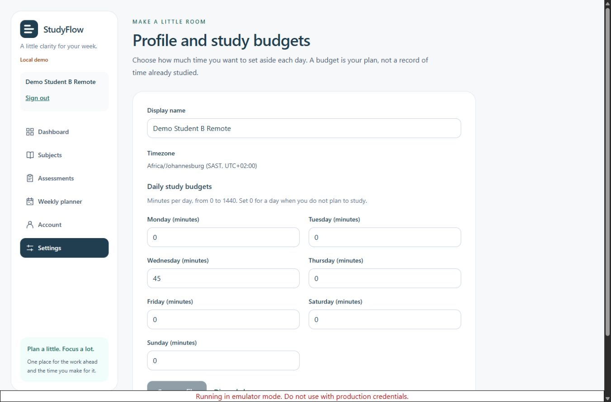
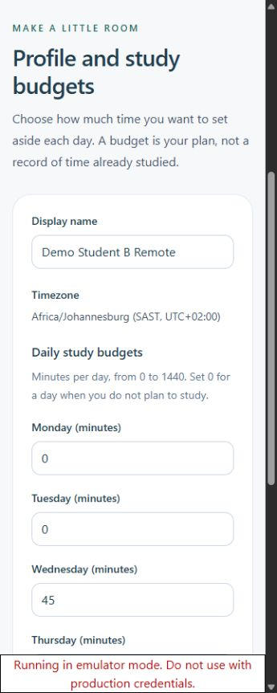

# Account/profile verification - 16 October 2026

Environment: Jandre's Windows Desktop checkout, Node 24.19.0, npm 11.17.0, Microsoft OpenJDK 21.0.8, Firebase SDK 13.0.0 and local demo-studyflow Auth/Firestore emulators. All accounts/data in these checks are synthetic. This record covers the account/profile package implemented at Jandre's request with assistant help; it does not attribute other members' contributions or claim a course submission/approval.

## Executed automated checks

| Check                                           | Actual result                                                                                         |
| ----------------------------------------------- | ----------------------------------------------------------------------------------------------------- |
| Clean npm ci from unchanged dependency lockfile | Passed; npm 11 install-script decisions are version-pinned in package.json                            |
| npm run check                                   | Passed: formatting, ESLint without warnings, strict TypeScript, 85 unit/UI tests and production build |
| npm run test:rules                              | Passed: 43 tests against the real local Firestore emulator                                            |
| npm run test:integration                        | Passed: 6 real Auth/Firestore profile-service integration tests                                       |
| Production build in default and emulator modes  | Passed; both compiled previews were exercised in a browser                                            |
| npm audit --omit=dev                            | 0 reported vulnerabilities                                                                            |

Total automated tests: **134**. These are executed implementation tests, not 134 academic acceptance cases. CI is configured to run core/rules/integration checks with Java 21. A new hosted CI run is not claimed by this local verification record; consult the actual PR/checks after publication.

## Browser checks actually executed

- Blank registration validates fields and focuses the first invalid input.
- Registration creates a real emulator Auth account and its own profile using the supplied name, seven zero budgets and server timestamps.
- Settings accepts 0 and 1440, rejects a negative budget, saves every day and updates the shared profile/name.
- Browser refresh retains the same-tab session and saved name/budgets.
- Sign-out clears displayed profile and unsaved form input; a signed-out direct planner URL opens sign-in.
- Invalid credentials show a handled error and retain entered fields.
- A second registered account gets its own profile/zero budgets and no first-account draft.
- Two separate browser sessions for one account were used to save a concurrent edit. The first session preserved its draft, disabled save and loaded the newer values only after explicit reload.
- Local rules were temporarily restricted to deny profile writes while retaining normal owner reads. A denied settings save showed an error, kept the entered name/budget and displayed no success.
- With writes still denied, new-account Auth creation succeeded and profile creation failed. The recovery page retained the supplied name and clearly stated that the account already existed. Repository rules were restored; Retry profile created the same account's profile successfully without another registration.
- All six navigation destinations, account/settings cross-links, missing-page recovery and a protected deep link worked.
- The skip link focused main-content. Tab traversed the name and all seven weekday inputs to Save profile; Enter saved successfully.
- Settings had no horizontal overflow at widths 360, 768 and 1366 pixels; desktop and mobile screenshots were visually inspected.
- Compiled default preview rendered its disabled-mode explanation. The compiled emulator build handled sign-in, profile save and reload. The final development and compiled-emulator browser checks had no console errors; expected SDK permission-denied warnings occurred during the intentional denial scenario.

The temporary browser-rule override was restored before final security/integration runs. Disposable browser test accounts were signed out. No cloud endpoint, CTU login, real student record or production deployment was used.

## Proof screenshots

The screenshots show synthetic local settings during the browser checks, not actual student records or completed dashboard functionality.

## Requirement coverage and limits

| Planned case/requirement | Evidence within this package                                                                                                                      |
| ------------------------ | ------------------------------------------------------------------------------------------------------------------------------------------------- |
| FR-01 / TC-01            | Local registration, login/errors and logout verified                                                                                              |
| TC-02 / NFR-01           | Session/profile clearing and UID change verified; other owners' future datasets still need their own lifecycle tests                              |
| TC-03/04/05 / NFR-01/02  | Own-profile isolation and schema checks verified; other collections currently deny all operations and need future positive/negative feature tests |
| FR-02 / TC-06/07         | Profile/budget editing, validation and reload persistence verified; dashboard workload recalculation remains pending                              |
| TC-29 / NFR-07           | Profile write denial, offline preflight, retries, idempotent creation and stale revisions verified; other feature saves remain pending            |
| TC-30 / NFR-04/05        | Account/profile screens checked for responsive/keyboard behaviour; full planner acceptance remains pending                                        |
| TC-32 / NFR-08           | Clean installation on this machine passed; a second member/machine has not been claimed                                                           |

## Issues found and resolved before final checks

1. SDK transactions alone did not respect the test's disabled-network state before a later confirmation read failed. A server-only preflight now rejects before the transaction when offline; the transaction re-reads for consistency. The integration test proves no queued/surprise offline edit appears after reconnection.
2. Vendor chunk splitting changed Firebase's component initialization order in the compiled build. Strict module execution order is now preserved. Both compiled modes were re-tested, including a real profile save/reload.
3. A fresh npm 11 install surfaced install-script review warnings. Exact installed versions of the three reviewed dependencies are now recorded in project-local allowScripts; no global policy was changed. A second clean install passed without pending-script warnings.

## Outstanding work

- Profile listing/deletion, password reset and institutional single sign-on are outside this module's defined requirements; there are no pretend links for those flows.
- Other feature CRUD/calculations, entity-specific schema/rules, full planner acceptance and dashboard budget recalculation remain with subsequent integration work.
- Shared cloud setup, real email/password provider/password-policy configuration and cloud/deployment verification have not occurred.
- The existing full dependency audit still reports 7 Firebase CLI development-tree findings (4 moderate, 3 high). See [dependency notes](../development/DEPENDENCIES.md); production audit is clear.
- Actual client feedback, Firestore assessment-fit acceptance, dissertation assembly/submission and genuine individual explanations remain course work, not inferred from passing tests.

Read the [design](../design/Accounts_and_Profile_Design.md) and [developer handoff](../development/ACCOUNTS_HANDOFF.md) for the implementation contract.
